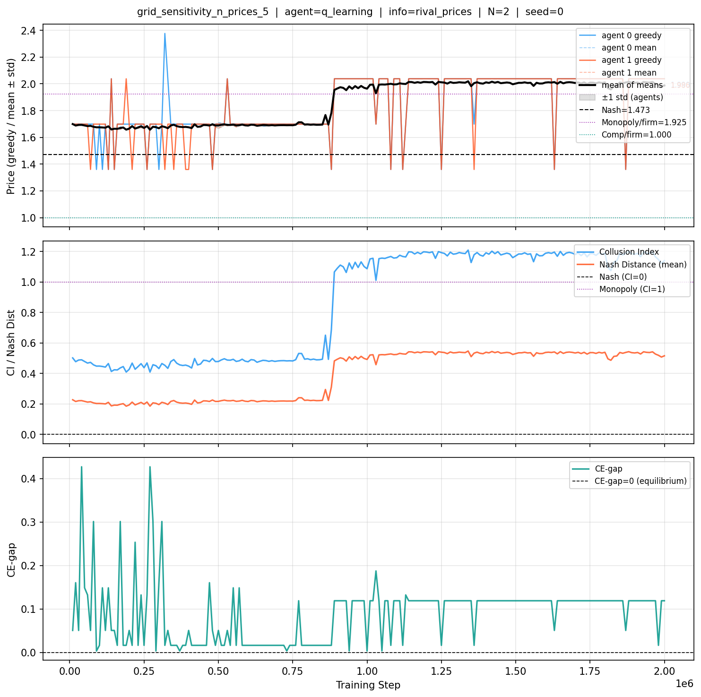

# Experiment: grid_sensitivity_n_prices_5

## Configuration
- Agent: q_learning | Seed: 0 | Steps: 2000000
- Market: N=2, demand=logit(a=2.00, μ=0.250), c=1.00
- Info structure: rival_prices

## Analytical Benchmarks
- Nash: p/firm=1.4729, q/firm=0.4714, π/firm=0.2229
- Monopoly: p/firm=1.9250, q/firm=0.3649
- Competitive: p/firm=1.0000

## Equilibrium Results (final window)

| Metric | Value | Interpretation |
|--------|-------|----------------|
| Collusion Index | 1.1626 | full collusion (near monopoly) |
| Nash Distance (mean) | 0.5256 | — |
| CE-gap | 0.1105 | deviation incentive present |
| Symmetry (std greedy) | 0.0000 | — |
| Dynamics | converging | — |

## Per-Agent Greedy Prices

| Agent | greedy_price | Nash dist |
|-------|----------|-----------|
| 0 | 2.0041 | 0.5312 |
| 1 | 2.0041 | 0.5312 |

## Interpretation

With **q_learning** agents under **rival_prices** information and **N=2** firms, the system is still converging. The collusion index is **1.163** (full collusion (near monopoly)), and the outcome is not consistent with equilibrium — agents have incentive to deviate (CE-gap = 0.1105). Positive CE-gap means at least one agent would benefit from deviating unilaterally — the current distribution is not an equilibrium.

## Training Curves

See [tables/equilibrium.md](tables/equilibrium.md) for full classification detail.
See [tables/per_agent.md](tables/per_agent.md) for per-agent breakdown.
